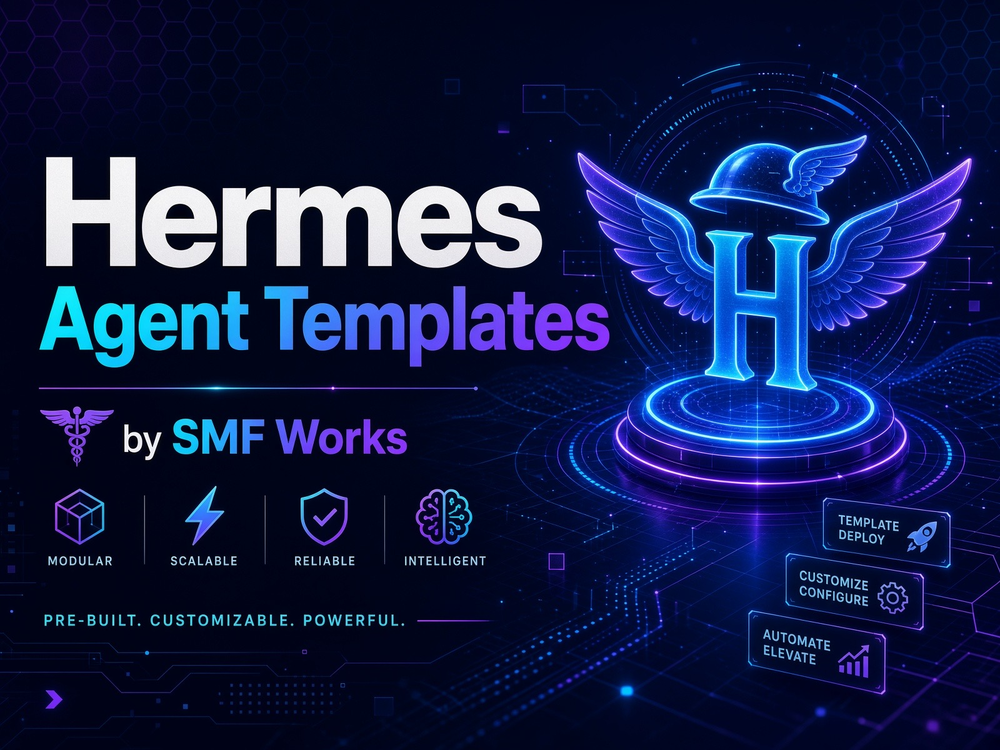

<p align="center">
  
</p>


# Hermes Agent Templates

Profile templates for [Hermes Agent](https://hermes-agent.nousresearch.com/docs), published by SMF Works under the MIT license.

Each template is a directory with its own `distribution.yaml`. Install from a checkout of that directory. `hermes profile install` reads `distribution.yaml` at the root of the path you give it, so a git URL of this whole repo is not an install target.

```bash
git clone https://github.com/smfworks/hermes-agent-templates.git
cd hermes-agent-templates
hermes profile install ./site-signal --name site-signal --alias
```

Replace `site-signal` with the template you want. The alias gives you a `site-signal` command, which is `hermes -p site-signal`.

## What's here

| Directory | What it does | Status |
|---|---|---|
| `site-signal` | Scans sites you own for SEO, GEO, AEO, AI readiness, and accessibility. Ranks issues by impact and opens fix PRs when you ask. | Reviewed (Paula, APPROVE). S6/S7 live cycle passed. |
| `builder-prime` | Plans, codes, tests, and opens pull requests. Never merges. Pair with Gatekeeper Prime. | Draft. Skills ported from prime-directive. Offline gates and a private sandbox handoff passed. Awaiting review. |
| `gatekeeper-prime` | Reviews every pull request and squash-merges only after the owner's GitHub review on that head SHA. | Draft. Same review as Builder Prime. |
| `bourne-bot` | Personal OPSEC advisor. Four Grok Bot skills, advice only, no terminal or web. | Draft. Verbatim skill port and contract tests on this PR. Awaiting live smoke and owner yes. |

New templates land as a pull request. Do not push to `main`. Do not commit `.env`, tokens, or session data.

## License

MIT. See [LICENSE](LICENSE). Copyright 2026 SMF Works.
